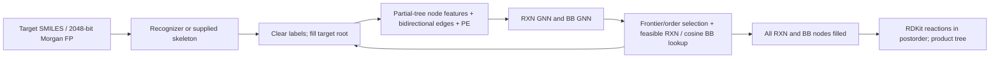

# Cliff-Aware SynthesisNet Generator — Phase 0

Inspected on 2026-10-03 (Asia/Shanghai), upstream commit
`2fefd24dd1b746165fd0b073f340f8ecbb2e15f4`. Branch: `codex/phase0-baseline`.
No upstream source was changed; no cliff model, experimental data, ACA loss, or
guided generation was introduced.

**Status: pretrained RXN and BB GNN forward inference passes. Complete-tree
baseline inference is blocked. Phase 1 must wait.** Numerical results and exact
versions are in [this directory](.); full predictions are generated at
`results/phase0/forward.json` (ignored by Git).

## Architecture and repository map

The upstream tree has 177 tracked entries, including two uninitialized submodule
gitlinks. [repository-inventory.txt](repository-inventory.txt) records
the complete inventory. These are distinct from new Phase 0 files.

| Location | Purpose |
| --- | --- |
| `src/synnet/models/mlp.py` | `MLP` recognizer/legacy networks; `GNNModel` predictor; Lightning `GNN` training wrapper |
| `src/synnet/models/gnn.py` | GNN datasets, 32-dimensional positional encoding, training entry point; not the architecture definition |
| `src/synnet/models/common.py` | `find_best_model_ckpt`, `load_gnn_from_ckpt`, `load_mlp_from_ckpt` |
| `src/synnet/utils/data_utils.py` | `Reaction`, `ReactionSet`, `SyntheticTree`, `Skeleton`, `SkeletonSet`, `Program`, product caches, binary-tree conversion |
| `src/synnet/utils/reconstruct_utils.py` | Skeleton recognition, model/data setup, iterative GNN decoding, feasibility filtering, RDKit reconstruction |
| `src/synnet/encoding/`, `MolEmbedder.py` | Morgan FPs, similarity, BB lookup; optional DGL molecular embeddings are separate from the tree GNN |
| `src/synnet/data_generation/` | BB/template loading and filtering, random trees, encoders and featurization |
| `src/synnet/models/{act,rt1,rxn,rt2,legacy}.py`, `utils/predict_utils.py` | Older SynNet action/BB/reaction MLP generator; not the SynthesisNet GNN baseline |
| `src/ga/`, `sandbox/optimize.py` | GA/GP/oracle optimization around the decoder |
| `src/synnet/policy/`, `envs/` | Optional reaction policy, MCTS, RL environments |
| `src/synnet/visualize/`, `figures/` | Molecule/reaction drawings, skeleton visualization and figures |
| `scripts/00–07*` | Original BB/tree/MLP data pipeline; `20–23*` are legacy prediction/evaluation |
| `scripts/process-for-gnn.py`, `split_data.py`, `analyze-skeletons.py`, `predict-skeleton.py` | GNN data preparation, canonical skeleton extraction, recognizer training/evaluation |
| `scripts/reconstruct-targets.py`, `reconstruct_listener.py`, `mcmc*.py`, `ga-surrogate.py` | GNN reconstruction, listener workers, analog search and GA entry points |
| Other `scripts/*.sh`, `sandbox/*.sh` | Training/search/cluster launch configurations, often author-specific paths |
| `scripts/*.ipynb`, `param_est/` | Analysis/exploration notebooks; separate experimental MRF/tree work |
| `data/assets/`, `tests/` | HB templates, sample targets and figures; small fixtures and legacy checkpoints/tests |
| `environment.yml`, `synnet*.yml`, `setup.py`, `README.md`, `INSTRUCTIONS.md` | Historical environments, package metadata and usage; setup.py declares no runtime dependencies |
| `retro_star/`, `Single-Player-MCTS/` | Uninitialized optional submodules; neither is required for the forward smoke test |

## Execution flow and representations



- `SyntheticTree`: chemical/reaction node lists, root, edges, action history
  (0 Add, 1 Expand, 2 Merge, 3 End), depth and reaction arity. JSON/gzip via
  `SyntheticTreeSet`; canonical skeleton pickle dictionaries map representative
  trees to isomorphic examples. Skeleton class IDs follow dictionary key order.
- `Skeleton`: alternating chemical/reaction `networkx.DiGraph`, edges from
  product toward reactants, ordered children, postorder integer node IDs and
  last-node root. Stores `tree_edges`, bidirectional edges, `leaves`, `rxns`,
  `mask` (1 means filled/available), frontier and traversal criteria.
- `set_models()` uses `load_gnn_from_ckpt()` →
  `GNN.load_from_checkpoint(map_location='cpu').model`; `wrapper_decoder()`
  calls this inner `GNNModel(Data)` in eval/no-grad mode. Both separately trained
  models have a 347-dimensional output; RXN uses its last 91 values and BB its
  first 256. They do not share a trained encoder.
- `predict_skeleton()` uses a 2048-bit Morgan FP, the MLP recognizer and
  `config.json['datasets']` to map classifier positions to canonical skeleton
  IDs. A supplied/gold skeleton avoids the recognizer.
- `decode()` → `clear_tree()` → `modify_tree(root, target)` → `wrapper_decoder()`.
  `Skeleton.get_state(rxn_target_down_bb=True, rxn_target_down=True)` produces
  4187 features per node: local 2048-bit FP + target FP repeated at every node
  + 91 reaction indicators. Unknown semantics are zero; intermediate local FPs
  are zeroed by the decoder. 32 sinusoidal PE values yield width 4219.
- Released predictors: five TransformerConv layers, four ReLU/dropout hidden
  blocks, hidden width 1200, final graph convolution to 347 outputs. Verified
  3-RXN uses the default one head/dropout 0.5; 3-NN uses eight averaged heads
  (`concat=False`)/dropout 0.0. There is no existing pooled `z_tree`.
- `pick_node()` selects a reaction by max logit or BB by minimum L1 distance;
  topological strategies choose from traversal orders. `fill_in()` applies
  arity/optional program-cache masks to RXN scores, then ranked selection;
  for BB it restricts catalog indices and calls cosine `nn_search_list()`.
  Beam expansion applies to the first BB and first RXN.
- `wrapper_decoder()` returns filled `Skeleton` objects, not automatically
  executed product trees. `Skeleton.reconstruct()` executes RDKit reactions
  bottom-up. The separate `reconstruct()` helper returns the molecule with
  highest Tanimoto among all valid chemical nodes, possibly an intermediate or
  BB; this is not proof of a valid root product or complete synthesis.

## Checkpoints and external assets

Published sources: [checkpoints](https://figshare.com/articles/dataset/28557581)
and [skeleton assets](https://figshare.com/articles/dataset/28658243).
[assets.json](assets.json) records file IDs, URLs, sizes and hashes.
Reused checkpoints are outside this Git checkout, under
`/home/doubo/projects/SynthesisNet-master/ckpts/` in WSL; only their weights and
hyperparameters are reused, never that older folder's source or chemical data.

| Asset | Location / requirement |
| --- | --- |
| RXN checkpoint used | `3-RXN/ckpts.epoch=27-val_accuracy_loss=0.36.ckpt` (470,660,159 bytes) |
| BB checkpoint used | `3-NN/ckpts.epoch=7-val_nn_accuracy_loss=0.67.ckpt` (2,941,355,775 bytes) |
| Recognizer available, not exercised | `3-REC/ckpts.epoch=1-val_loss=0.14.ckpt` + matching `config.json` |
| Other released checkpoints | `4-NN/`, `4-RXN/`, `4-REC/` also present externally; not exercised |
| Training skeleton dictionary | Downloaded and MD5 verified at `/home/doubo/SynthesisNet/results/viz/skeletons-train.pkl`; required by upstream gnn.py at import time |
| Canonical test/validation/full skeleton dictionaries | Released by Figshare; not downloaded; required for matching split/class evaluation |
| HB reaction templates | Tracked `data/assets/reaction-templates/hb.txt` (91 ordered templates) |
| Matched Enamine catalog | Missing `data/assets/building-blocks/enamine_us_matched.csv`; upstream used US Stock catalog requiring vendor access |
| BB embedding matrix | Missing canonical `enamine_us_emb_fp_256.npy`, aligned row-for-row with the catalog; also loaded by checkpoint training wrapper |
| Reaction collection | Missing `data/assets/reaction-templates/reactions_hb.json.gz`, including available-reactant lists aligned with templates/catalog |
| Optional decode assets | Program/hash JSON caches for `filter_only=['rxn','bb']`, optional top-BB list, 2048-bit BB embeddings for GA stump lookup |
| Optional application assets | ChEMBL targets for batch analog scripts; TDC model/oracle downloads, docking executables/protein files for relevant objectives; not needed for fixed-skeleton forward inference |

The bundled three-template/100-BB fixtures and older MLP `.ckpt` files are not
substitutes for the released GNN's 91-template/canonical-catalog baseline.

## Successful numerical baseline

Run from the repository root in WSL with the clean Python 3.9.18 CPU environment
at `/home/doubo/.cache/cliffnet/phase0-clean`. Its install command and Windows
launcher are in [RUNBOOK.md](RUNBOOK.md).

```bash
PYTHONPATH=src /home/doubo/.cache/cliffnet/phase0-clean/bin/python -m cliffnet.baseline \
  --checkpoint /home/doubo/projects/SynthesisNet-master/ckpts/3-RXN/ckpts.epoch=27-val_accuracy_loss=0.36.ckpt \
  --checkpoint /home/doubo/projects/SynthesisNet-master/ckpts/3-NN/ckpts.epoch=7-val_nn_accuracy_loss=0.67.ckpt
```

Path: `cliffnet.baseline.prepare_input()` → unchanged `SyntheticTreeSet`,
`Skeleton.get_state()`, `PtrDataset.positionalencoding1d()`;
`load_predictor()` → unchanged `GNNModel`, strict `model.*` state restoration →
`GNNModel.forward()`. The harness bypasses only the Lightning wrapper's missing
training validation-embedding file, and does not execute `fill_in()`.

Input: first bundled `tests/data/ref/st_data.json.gz` tree (two BB leaves, one
reaction, one target root), stripped of every label except target
`CCOc1ccc(C2NCCc3c2cc(OC)c(OC)c3OC)o1`. Root-only mask `[0,0,0,1]`,
`Data.x=[4,4219]`, `edge_index=[2,6]`.
Output: finite `[4,347]` raw node predictions for each pretrained model, identical
on repeated eval calls. The JSON report explicitly marks complete-tree inference
false. Argmax RXN values in the report are unmasked diagnostics, not actions.

Validation: four new tests cover exact parity with the upstream Lightning loader
on a small checkpoint, target-only features, and missing/unexpected-weight
rejection. The three discoverable upstream optimization tests also pass.
Golden hashes describe this CPU runtime, not guaranteed cross-platform equality.

## Future insertion points — design only

Safest semantic location for `encode_tree()` is `GNNModel.forward()` in
`src/synnet/models/mlp.py`, immediately before its final graph convolution:
retain the `[N,1200]` hidden tensor and pool it by `Data.batch` into `z_tree`.
Start with an adapter/hook in `src/cliffnet/encoding.py` to observe the existing
penultimate tensor; preserve upstream forward output, module names and checkpoint
keys. Keep BB and RXN embeddings separate until an explicit fusion design exists.

Candidate observation belongs in `wrapper_decoder()` / `pick_node()` / `fill_in()`
in `src/synnet/utils/reconstruct_utils.py`, after validity masks and catalog-index
restrictions, before ranked RXN or cosine BB selection. Preserve node/type,
catalog/template ID, score, feasibility mask and beam rank. Raw logits alone
are insufficient. A later decoding callback can live in `src/cliffnet/decoding.py`.
Thus at most two upstream files need small API seams; no data representation or
training-pipeline rewrite is required. None of these additions is implemented.

## Unresolved issues and Phase 1 gate

[ISSUES.md](ISSUES.md) distinguishes observed failures from static
code findings and records resolved environment/path issues and exact failed
commands. Principal blockers: canonical Enamine CSV/FP matrix/reaction collection,
native loader's embedding dependency, and native decoder's TDC import. TDC's
published dependency metadata requests a second RDKit distribution; installation
was dry-run only to preserve the verified chemical runtime.

Before experimental data: obtain/provenance-check the aligned chemical assets,
resolve TDC dependencies in isolation, run one fixed-skeleton native decoding
case, and verify filled nodes, executed reactions and a valid root SMILES.
Then verify recognizer class mapping and a target-to-skeleton-to-product run.
Do not treat this forward smoke test as clearance for Phase 1.
